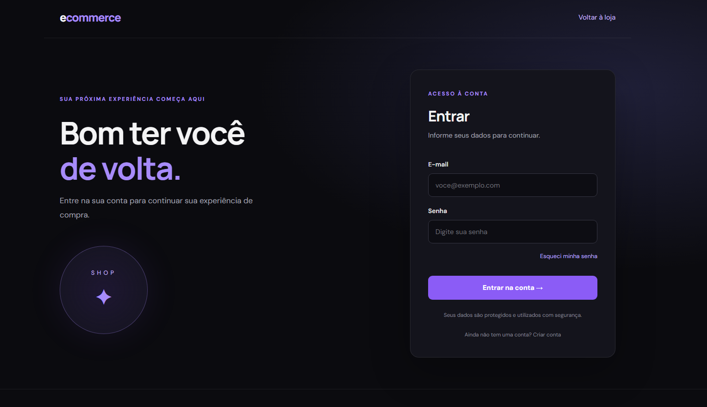
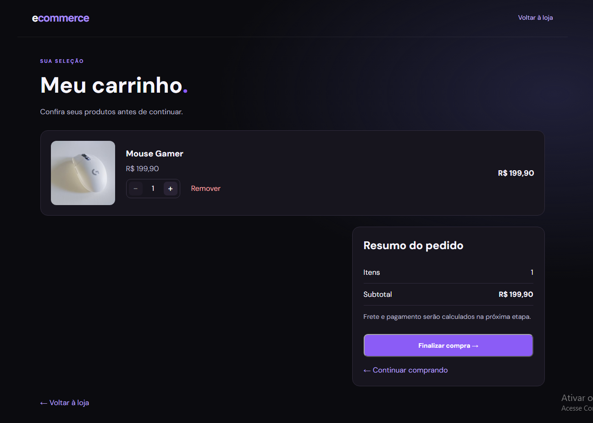
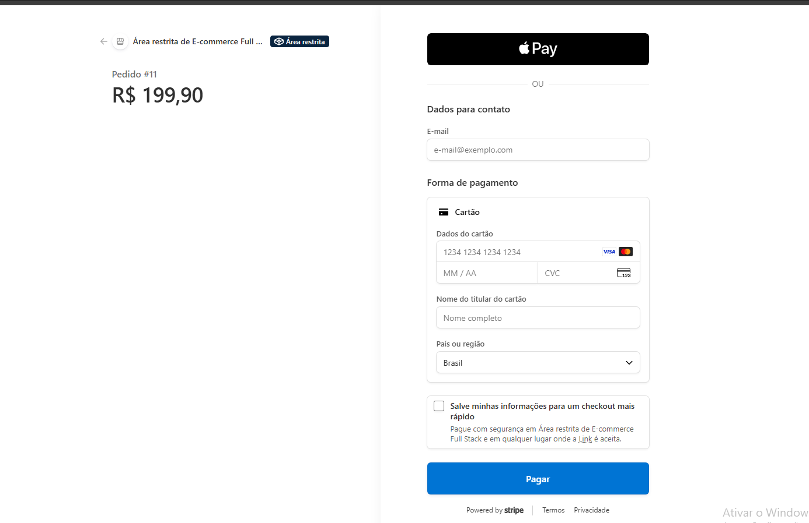
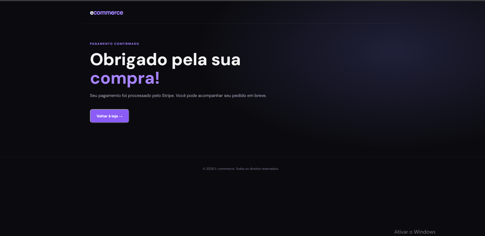

# E-commerce Full Stack

A full-stack e-commerce application built with FastAPI, React, PostgreSQL, and Stripe. This project demonstrates REST API development, authentication, shopping cart management, payment processing, and automated testing.

## Application Screenshots

### Login


### Product Catalog


### Shopping Cart


### Product Added to Cart


### Stripe Checkout


### Payment Confirmation



## Features

- User registration and authentication with JWT
- Product catalog and category management
- Shopping cart management
- Order creation and order status tracking
- Stripe payment integration and webhook processing
- Webhook idempotency to prevent duplicate event processing
- Email notifications and background email processing
- Password reset workflow
- PostgreSQL database and Alembic migrations
- Automated backend tests

## Tech Stack

### Backend
- Python
- FastAPI
- SQLAlchemy
- PostgreSQL
- Alembic
- Pydantic
- JWT authentication
- Stripe API
- Pytest

### Frontend
- React
- Vite
- JavaScript
- HTML and CSS

### Infrastructure and integrations
- Docker and Docker Compose
- Stripe test mode
- SMTP email integration

## Project Structure

```text
ecommerce-fullstack/
├── backend/
│   ├── alembic/
│   ├── app/
│   ├── tests/
│   ├── .env.example
│   ├── docker-compose.yml
│   └── requirements.txt
└── frontend/
    ├── public/
    ├── src/
    ├── package.json
    └── vite.config.js
```

## Getting Started

### Prerequisites

- Python 3.12 or a compatible version supported by the dependencies
- Node.js and npm
- Docker Desktop
- A Stripe account for payment testing
- SMTP credentials for email functionality

### 1. Clone the repository

```bash
git clone https://github.com/diegosantos-io/ecommerce-fullstack.git
cd ecommerce-fullstack
```

### 2. Configure the backend

```bash
cd backend
python -m venv venv
```

Activate the virtual environment on Windows PowerShell:

```powershell
.\venv\Scripts\Activate.ps1
```

Install dependencies:

```bash
python -m pip install -r requirements.txt
```

Create your local environment file from the example:

```powershell
Copy-Item .env.example .env
```

Update `.env` with your own database URL, JWT secret, Stripe test credentials, and SMTP settings. Never commit your real `.env` file.


### 3. Start PostgreSQL

From the `backend` directory, create your local environment file:

```powershell
Copy-Item .env.example .env
```

Edit `.env` and set a strong, unique local value for `POSTGRES_PASSWORD`. Keep this file private and never commit it.

The Compose configuration reads variables from `.env` when running Docker Compose. The database settings in `DATABASE_URL` must match the database name, username, password, host, and port configured for your local environment.

Validate the Compose configuration:

```bash
docker compose config --quiet
```

Start PostgreSQL:

```bash
docker compose up -d db
```

Apply database migrations:

```bash
alembic upgrade head
```


### 4. Start the backend API

From the `backend` directory:

```bash
python -m uvicorn app.main:app --reload
```

The API is expected to be available at:

http://localhost:8000

FastAPI interactive documentation:

http://localhost:8000/docs

### 5. Start the frontend

Open a separate terminal:

```bash
cd frontend
npm install
npm run dev
```

Open the local URL printed by Vite in the terminal.

## Stripe Payment Testing

Use Stripe test-mode credentials and test payment methods only. Configure the webhook endpoint to point to the payment webhook route implemented by the backend.

The backend includes webhook processing designed to avoid duplicate event handling. Configure the Stripe CLI or Stripe Dashboard according to your local development setup.

Never use production secret keys in local examples or commit them to version control.

## Running Tests

From the `backend` directory, activate the virtual environment and run:

```bash
python -m pytest .\tests -v
```

Some integration tests require a separately configured test database and appropriate environment variables. Do not run tests against a production database.

## Security Notes

- Keep `.env` files out of version control.
- Use unique, strong secrets for JWT authentication.
- Use Stripe test credentials during development.
- Keep email credentials private.
- Use a dedicated test database for automated tests.

## Roadmap

- Improve automated frontend testing
- Add deployment configuration
- Add screenshots and a live demo
- Expand API documentation

## Author

Diego Santos

GitHub: https://github.com/diegosantos-io

LinkedIn: https://www.linkedin.com/in/diego-santos-3352a92a8/

---

This project was developed for learning and portfolio purposes.
